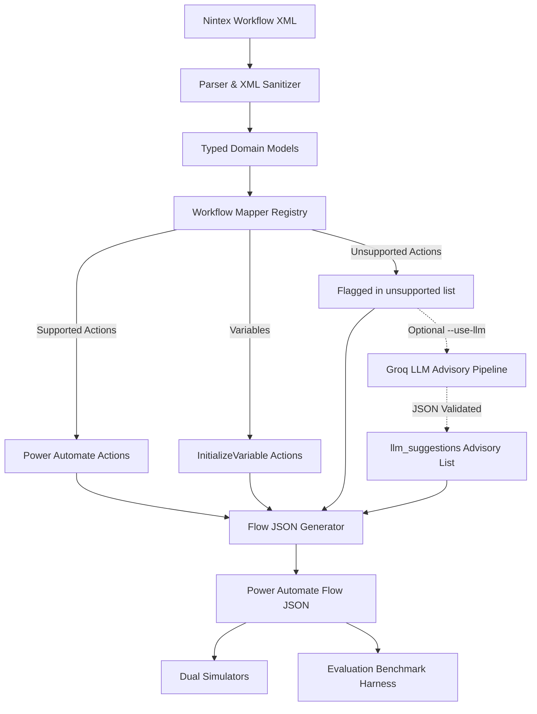

# Nintex-to-Power-Automate Workflow Converter

Nintex-to-Power-Automate Converter is an enterprise migration utility and developer toolchain that parses legacy Nintex Workflow definitions (XML exports), validates their structure, and maps them deterministically into modern Microsoft Power Automate cloud flow definitions. The toolchain provides a deterministic rule-based core, an advisory LLM fallback engine for unsupported patterns, dual runtime simulation engines for behavioural equivalence verification, an automated evaluation harness, an MCP (Model Context Protocol) stdio server for LLM agents, and a FastAPI REST service featuring an HMAC-SHA256 authenticated webhook receiver.

---

## 🏗️ Architecture

```
                                  +-----------------------------+
                                  |   Nintex Workflow XML       |
                                  | (File / String / Webhook)   |
                                  +--------------+--------------+
                                                 |
                                                 v
                                  +-----------------------------+
                                  |    Parser & Sanitizer       |
                                  | (XXE Safe, 200KB limit)     |
                                  +--------------+--------------+
                                                 |
                                                 v
                                  +-----------------------------+
                                  |   Typed Workflow Models     |
                                  | (Workflow, Action, Variable)|
                                  +--------------+--------------+
                                                 |
                                                 v
                                  +-----------------------------+
                         +------->|   Rule-Based Mapper Core    |<-------+
                         |        +--------------+--------------+        |
                         |                       |                       |
            (Rule Supported)            (Unsupported Actions)      (Declared Variables)
                         |                       |                       |
                         v                       v                       v
               +------------------+    +-------------------+   +--------------------+
               | Power Automate   |    | Flagged for Review|   | InitializeVariable |
               | Action Registry  |    | (Needs Review=true|   | Actions Injected   |
               +---------+--------+    +---------+---------+   +---------+----------+
                         |                       |                       |
                         |               (Optional --use-llm)            |
                         |                       |                       |
                         |                       v                       |
                         |             +-------------------+             |
                         |             |  Groq LLM Engine  |             |
                         |             | (Advisory Only,   |             |
                         |             |  Separate Field)  |             |
                         |             +---------+---------+             |
                         |                       |                       |
                         +-----------------------+-----------------------+
                                                 |
                                                 v
                                  +-----------------------------+
                                  |   Sequential Generator      |
                                  |  (runAfter Dependencies)    |
                                  +--------------+--------------+
                                                 |
                                                 v
                                  +-----------------------------+
                                  |  Power Automate Flow JSON   |
                                  +--------------+--------------+
                                                 |
                 +-------------------------------+-------------------------------+
                 |                                                               |
                 v                                                               v
   +---------------------------+                                   +---------------------------+
   |   Dual Runtime Simulators |                                   | Evaluation Benchmark      |
   | (simulate_nintex vs PA)   |                                   | (Structure, Expressions,  |
   +-------------+-------------+                                   |  Behaviour, Coverage)     |
                 |                                                 +---------------------------+
                 v
   +---------------------------+
   | Behavioral Equivalence    |
   | (Side-effect Trace Match) |
   +---------------------------+
```



---

## ⚡ Quick Start (Windows PowerShell)

Ensure Python 3.10+ is installed and accessible via `py` or `python`:

```powershell
# 1. Navigate to the converter directory
cd "nintex-converter"

# 2. (Optional) Create and activate a virtual environment
py -m venv .venv
.\.venv\Scripts\Activate.ps1

# 3. Install dependencies
py -m pip install -r requirements.txt

# 4. Run the full test suite (Phase 1 through Phase 5)
py -m pytest -v

# 5. Convert a sample workflow (deterministic, no network calls)
py -m src.convert samples/01_leave_approval.xml -o output/01.json
```

---

## 🖥️ Usage: CLI, MCP Server, and REST API

### 1. Command Line Interface (CLI)

```powershell
# Convert a workflow deterministically (LLM OFF by default)
py -m src.convert samples/01_leave_approval.xml -o output/01.json

# Convert an unsupported action workflow (flags manual review, zero network calls)
py -m src.convert samples/04_unsupported_loop.xml -o output/04.json

# Optional: Run with AI advisory suggestions (requires GROQ_API_KEY in .env)
py -m src.convert samples/04_unsupported_loop.xml -o output/04_llm.json --use-llm

# Visualize XML workflow hierarchy as an ASCII tree
py -m src.parser samples/01_leave_approval.xml
```

### 2. Model Context Protocol (MCP) Server

The MCP server runs over standard I/O (`stdio` transport) using the official MCP Python SDK (`FastMCP`), exposing three tools to LLM agents:
- `convert_workflow(workflow_xml: str, use_llm: bool = False)`: Converts XML and returns flow JSON and summary report.
- `validate_workflow(workflow_xml: str)`: Parses XML without conversion, returning workflow name, action count, distinct action types, and variables.
- `list_supported_actions()`: Returns supported and unsupported action registry mappings.

```powershell
# Launch MCP server over stdio
py -m src.mcp_server

# Run the included MCP stdio client demo
py examples/mcp_client_demo.py
```

### 3. REST API & Webhook Service

The FastAPI application provides conversion and webhook endpoints:
- `GET /health`: Service liveness probe.
- `POST /convert`: Accepts `{"workflow_xml": "...", "use_llm": false}` and returns the converted flow JSON.
- `POST /webhook/workflow-exported`: Accepts `{"event": "workflow.exported", "workflow_xml": "..."}` and requires header `X-Signature = HMAC-SHA256(raw_body, WEBHOOK_SECRET)`. Returns `401` for invalid/missing signatures and `503` if `WEBHOOK_SECRET` is unset.

```powershell
# Start REST API server with hot reload
py -m uvicorn src.api:app --reload

# In another terminal: Test health check
Invoke-RestMethod -Uri "http://127.0.0.1:8000/health" -Method Get

# Direct conversion via REST
$body = @{ workflow_xml = (Get-Content samples/01_leave_approval.xml -Raw); use_llm = $false } | ConvertTo-Json
Invoke-RestMethod -Uri "http://127.0.0.1:8000/convert" -Method Post -ContentType "application/json" -Body $body
```

---

## 🔌 Registering the MCP Server in an MCP Client

To register this converter as an MCP tool provider in an MCP client (such as Claude Desktop, Cursor, or Antigravity), add the following configuration block to your client's MCP configuration file (e.g. `claude_desktop_config.json`):

```json
{
  "mcpServers": {
    "nintex-converter": {
      "command": "py",
      "args": [
        "-m",
        "src.mcp_server"
      ],
      "cwd": "C:/path/to/nintex-converter",
      "env": {
        "PYTHONUNBUFFERED": "1"
      }
    }
  }
}
```

> Replace `C:/path/to/nintex-converter` with the absolute path to your local repository directory.

---

## 🔄 Nintex to Power Automate Mapping Table

| Nintex Action | Power Automate Action / Trigger | Connector / Control Type | Notes & Field Translations |
| :--- | :--- | :--- | :--- |
| `Start` | **Manual (Request) Trigger** | `Request` / `Button` | Flow entrypoint; triggered manually or on item creation. |
| `SendEmail` | **Send an email (V2)** | `OpenApiConnection` (Office 365 Outlook) | Translates `to`, `subject`, and HTML `body` parameters. |
| `RequestApproval` | **Start and wait for an approval** | `OpenApiConnection` (Approvals) | Translates `approver`, `task_title`, and approval type (`EveryoneMustApprove`). |
| `Condition` | **Condition (If)** | `If` Control | Evaluates expressions; branches into `actions` (Then) and `else.actions` (Else). |
| `SetVariable` | **Set variable** | `SetVariable` Control | Updates the value of a declared workflow variable. |
| *(Workflow Variables)* | **Initialize variable** | `InitializeVariable` Control | Injected at flow start for every `<Variable>` declared in the workflow root. |

---

## 📊 Supported vs Unsupported Actions

| Action Type | Rule Engine Status | AI Fallback Strategy | Handling Details |
| :--- | :--- | :--- | :--- |
| `Start` | **Supported** | N/A | Maps directly to root manual trigger. |
| `SendEmail` | **Supported** | N/A | Maps to Office 365 Outlook connector. |
| `RequestApproval` | **Supported** | N/A | Maps to Approvals connector; outcome mapped to `Approve`/`Reject`. |
| `Condition` | **Supported** | N/A | Maps to `If` control with recursive branch conversion. |
| `SetVariable` | **Supported** | N/A | Maps to `SetVariable` control. |
| `Loop` | *Unsupported* | **AI-Suggested** (`Until` / `Foreach`) | Preserved in `unsupported`; AI suggests `Until` with inverted termination condition. |
| `WebServiceCall` | *Unsupported* | **AI-Suggested** (`Http`) | Preserved in `unsupported`; AI suggests standard HTTP request action. |
| `Parallel Branches` | *Unsupported* | **AI-Suggested** (`Scope` / parallel) | Preserved in `unsupported`; complex branching requires manual review. |
| `Custom Code / Script` | *Unsupported* | **AI-Suggested** | Preserved in `unsupported`; flagged for human migration review. |

---

## 🔬 Evaluation Method & Benchmark Results

### Evaluation Method
The benchmark harness (`evals/run_evals.py`) assesses conversion fidelity across 8 test workflows using a multi-dimensional scoring formula:

$$\text{Fidelity} = \max\Big(0, 0.25 \times \text{Structure} + 0.25 \times \text{Expression} + 0.30 \times \text{Behaviour} + 0.20 \times \text{Coverage} - (5 \times \text{Warnings})\Big)$$

- **Structure Score (25%)**: Validates trigger kind, action count, and action type sequencing against verified regression snapshots.
- **Expression Score (25%)**: Validates expression conversions (variables, outcomes) against independent ground-truth expectations.
- **Behaviour Score (30%)**: Dual simulation engines (`simulate_nintex` vs `simulate_power_automate` in `src/simulate.py`) execute both representations side-by-side and assert exact matches across runtime side-effect traces (emails dispatched, approval decisions, variable mutations).
- **Coverage % (20%)**: Ratio of successfully converted actions to total actions.
- **Warning Penalty**: Each expression or conversion warning penalizes fidelity by 5 points.

### Conversion Fidelity Benchmark Results

From `evals/results/latest.md`:

| Sample | Structure | Expression | Behaviour | Coverage | Unsup. | Warn. | Fidelity | Status |
| :--- | :--- | :--- | :--- | :--- | :--- | :--- | :--- | :--- |
| `01_leave_approval` | 100.0% | 100.0% | 100.0% | 100.0% | 0 | 0 | **100.0%** | PASS |
| `02_simple_email` | 100.0% | 100.0% | 100.0% | 100.0% | 0 | 0 | **100.0%** | PASS |
| `03_set_variable` | 100.0% | 100.0% | 100.0% | 100.0% | 0 | 0 | **100.0%** | PASS |
| `04_unsupported_loop` | 100.0% | 100.0% | 100.0% | 66.67% | 1 | 0 | **93.3%** | Expected Fallback |
| `05_nested_conditions` | 100.0% | 100.0% | 100.0% | 100.0% | 0 | 0 | **100.0%** | PASS |
| `06_variable_in_condition` | 100.0% | 100.0% | 100.0% | 100.0% | 0 | 0 | **100.0%** | PASS |
| `07_bad_reference` | 100.0% | 100.0% | 100.0% | 100.0% | 0 | 1 | **95.0%** | PASS (Penalty applied) |
| `08_multiple_unsupported` | 100.0% | 100.0% | 100.0% | 60.0% | 2 | 0 | **92.0%** | Expected Fallback |

### LLM Advisory Evaluation: Prompt Iteration

| Prompt Iteration | Type-Correct | Schema-Valid Rate | Mean Confidence | Observations / Findings |
| :--- | :--- | :--- | :--- | :--- |
| **Before prompt change** | 1/3 (33.3%) | 100.0% | 0.87 | Baseline prompt suggested non-standard `DoUntil` for loop actions. |
| **After prompt change** | **3/3 (100.0%)** | 100.0% | 0.92 | Explicit action enum constraints and Until termination guidance achieved 100% type accuracy on the 3-case smoke test (`act-2` Loop -> `Until`, `act-2` Loop -> `Until`, `act-4` WebServiceCall -> `Http`). |

> **Manual Evaluation Finding**: While the prompt change enabled the LLM to select the correct action type (`Until`) and invert the condition logic correctly (e.g. `@greaterOrEquals(...)` instead of `@less(...)`), manual review revealed that the exact Power Automate `Until` dictionary layout (such as `expression` vs `inputs.condition`) and integer type casting in limit expressions (`limit: 10` vs string) still require developer inspection.

---

## 🔒 Security Notes

1. **XML Ingestion Limits & Type Enforcement**: XML input is accepted strictly as an in-memory string (never as a file path or URL from untrusted callers), and inputs exceeding 200 KB are rejected immediately.
2. **XXE & Entity Expansion Defense**: Payloads containing `<!DOCTYPE` or `<!ENTITY` declarations are immediately rejected prior to XML parsing, preventing XML External Entity (XXE) attacks, external file disclosures, SSRF, and Billion Laughs denial-of-service exploits.
3. **Webhook HMAC-SHA256 Signature Verification**: The webhook endpoint (`/webhook/workflow-exported`) requires an `X-Signature` header computed as the HMAC-SHA256 of the raw request payload using `WEBHOOK_SECRET`. Constant-time comparison (`hmac.compare_digest`) prevents timing attacks. If `WEBHOOK_SECRET` is unset, the endpoint returns HTTP 503 and refuses all requests.
4. **LLM Disabled by Default**: The LLM integration is strictly opt-in (`--use-llm` in CLI, `use_llm: true` in API/MCP). When disabled, zero network calls are initiated and zero credentials are required.
5. **API Key Isolation**: `GROQ_API_KEY` is loaded from environment variables and is never exposed in output JSON, conversion reports, logs, or API responses.
6. **AI Output Advisory Policy**: LLM suggestions are treated as untrusted, non-authoritative recommendations. They are placed in an isolated `llm_suggestions` field and are **never** auto-merged into verified flow actions. Converted definitions containing unsupported actions always retain `needs_manual_review: true`.

---

## ⚠️ Known Issues / Unverified Items

1. **Power Automate Identifiers in `src/pa_constants.py`**: The operation IDs and schema identifiers (specifically `O365_OPERATION_ID_SEND_EMAIL_V2 = "SendEmailV2"` and `APPROVALS_TYPE_FIRST_TO_RESPOND = "EveryoneMustApprove"`) are simplified representations tailored for migration modeling and must be validated against Microsoft Power Automate connector documentation for production deployment.
2. **Simplified Nintex XML Samples**: The XML files in `samples/` emulate Nintex workflow logic and settings for demonstration and testing purposes. Real-world Nintex deployments export proprietary `.nwf` archive packages requiring XML decompression and schema extraction.
3. **Simulation Coverage**: The dual runtime simulation engines in `src/simulate.py` cover only the 5 supported action types (`Start`, `SendEmail`, `RequestApproval`, `Condition`, `SetVariable`). Unsupported actions are flagged for review and are not executed in simulation.
4. **Live LLM Smoke Test Scope**: The live LLM benchmark is a 3-case smoke test over samples 04 and 08 evaluating action type classification and basic schema validity. Full semantic validation and complex looping expressions require human developer review.

---

## 📁 Project Structure

```
nintex-converter/
├── .env.example              # Template environment configuration (GROQ_API_KEY, WEBHOOK_SECRET)
├── .gitignore                # Git exclusions (.env, .venv, __pycache__, output/, etc.)
├── LICENSE                   # MIT License (Abihail Nans Kuiper, 2026)
├── README.md                 # Complete system documentation and guides
├── requirements.txt          # Python dependencies (mcp, fastapi, uvicorn, httpx, etc.)
├── examples/
│   └── mcp_client_demo.py    # MCP stdio client demonstration script
├── evals/
│   ├── run_evals.py          # Benchmark evaluation CLI harness
│   ├── expected_handwritten.json # Ground-truth benchmark expectations
│   ├── golden/               # Regression golden output snapshots
│   └── results/
│       ├── latest.md         # Latest conversion fidelity benchmark report
│       └── llm_latest.md     # Latest live LLM evaluation benchmark report
├── samples/                  # 8 workflow XML scenarios (01 to 08)
├── src/
│   ├── __init__.py           # Package initializer
│   ├── api.py                # FastAPI REST API & HMAC webhook receiver
│   ├── convert.py            # CLI entrypoint for workflow conversions
│   ├── expressions.py        # Token parser and expression translator
│   ├── generator.py          # Power Automate flow JSON generator
│   ├── llm.py                # Groq LLM integration with retry & injection defense
│   ├── llm_schema.py         # Pydantic schemas for structured AI suggestions
│   ├── mapper.py             # Rule-based action mapping and registry
│   ├── mcp_server.py         # FastMCP stdio server exposing converter tools
│   ├── models.py             # Strongly typed Pydantic workflow models
│   ├── pa_constants.py       # Centralized Power Automate schema constants
│   ├── parser.py             # XML parser with nested branch handling
│   ├── service.py            # Shared core conversion and validation service layer
│   └── simulate.py           # Dual runtime simulators for behavioral testing
└── tests/
    ├── test_api.py           # REST API & webhook endpoint tests (FastAPI TestClient)
    ├── test_behaviour.py     # Runtime behavioral equivalence tests
    ├── test_converter.py     # Rule-based converter & mapper tests
    ├── test_evals.py         # Evaluation benchmark harness tests
    ├── test_expressions.py   # Expression parser tests
    ├── test_llm.py           # Mocked LLM integration & security tests
    ├── test_mcp.py           # MCP tool registration and equivalence tests
    ├── test_parser.py        # XML parser tests
    └── test_service.py       # Service layer validation & security tests
```

---

## 🗺️ Roadmap

- [ ] **Full Nintex `.nwf` Archive Extractor**: Support unpacking `.nwf` binary packages and embedded workflow schemas.
- [ ] **Expanded Action Library**: Add rule-based translation handlers for `Switch`, `Scope`, `Terminate`, and `Call Web Service`.
- [ ] **Interactive Visual Flow Preview**: Render flow diagrams directly in the browser or terminal before deployment.
- [ ] **Power Platform Solution Packager**: Automatically package converted flow definitions into deployable Power Platform Solution `.zip` archives.
